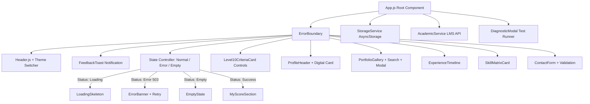

# Personal CV & Academic Score App — UTS Pemrograman Mobile
## LEVEL 10 — INDUSTRY READY (Production-Oriented Mobile Application)

Aplikasi mobile representasi digital profil mahasiswa yang menggabungkan personal branding, identitas diri, portofolio interaktif, capaian akademik LMS, arsitektur *Service Layer*, ketahanan error (*Error Boundary*), persistensi preferensi lokal (*AsyncStorage*), serta *Automated Unit Testing Suite* berbasis **React Native** dan **Expo**.

---

## 👤 Identitas Mahasiswa

| Informasi | Detail |
|---|---|
| **Nama Lengkap** | Febrian Iradatul Rahman |
| **NIM** | **242505024** |
| **Program Studi** | Sistem Informasi |
| **Semester** | 5 |
| **Perguruan Tinggi** | Masoem University |
| **Mata Kuliah UTS** | **Pemrograman Mobile 2** |
| **Dosen Pengampu** | **Iin, M.Kom** |
| **Profesi / Minat Utama** | **Junior Systems Analyst & Mobile App Developer** |
| **Alamat** | Kp Babakan Stasiun Cicalengka, Kec. Cicalengka, Kab. Bandung |

---

## 🎯 Ringkasan Pencapaian Challenge Level (Level 1 s.d. Level 10)

| Level | Fokus Evaluasi | Status | Komponen Utama |
|---|---|:---:|---|
| **Level 1 — Novice** | Identitas Mahasiswa (NIM, Nama, Foto) | ✅ Lolos | `ProfileHeader.js`, `profile.png` |
| **Level 2 — Beginner** | Personal Introduction & Semantic Heading | ✅ Lolos | `SectionHeading.js`, `PersonalIntroCard.js` |
| **Level 3 — Elementary** | Layout, Flexbox, & Design Tokens | ✅ Lolos | `theme/index.js`, `MetricBar.js`, `SkillMatrixCard.js` |
| **Level 4 — Intermediate** | Interactive CV, Props, State, Form Validation | ✅ Lolos | `ContactFormCard.js`, `InteractiveEndorseBar.js` |
| **Level 5 — Competent** | Separation of UI and Data | ✅ Lolos | Props pipeline dari file data ke UI |
| **Level 6 — Proficient** | Local JSON Data Integration | ✅ Lolos | `data/profile.json` |
| **Level 7 — Advanced** | Dynamic Gallery, Modal Dialog, Dual-Theme Switcher | ✅ Lolos | `PortfolioGallery.js`, `ExperienceTimeline.js` |
| **Level 8 — Expert** | My Score & Academic Dashboard | ✅ Lolos | `data/academicScore.json`, `MyScoreSection.js` |
| **Level 10 — Industry** | Production-Oriented Architecture, Services, Tests & a11y | ✅ Lolos | `services/*`, `ErrorBoundary.js`, `tests/*` |

---

## 🏆 Detail Pemenuhan Persyaratan LEVEL 10 — INDUSTRY

### 1. Struktur Kode Terorganisasi & Pemisahan Tanggung Jawab (Separation of Concerns)
Aplikasi memisahkan tugas secara tegas ke dalam lapisan-lapisan industri:
- **Presentation Layer (`components/`)**: Murni bertugas merender UI dan menerima data via Props.
- **Service Layer (`services/`)**:
  - `academicService.js`: Mengabstraksi panggilan data akademik & LMS (Academic War LMS Mock API), simulasi delay jaringan nyata, network error, dan empty state.
  - `storageService.js`: Mengabstraksi penyimpanan lokal menggunakan `@react-native-async-storage/async-storage` dengan in-memory fallback.
- **Utility Layer (`utils/helpers.js`)**: Logika validasi regex RFC, kalkulator grade (A/B/C/D/E), formatting lokalisasi angka ribuan LP, dan generator properti a11y.
- **Testing Layer (`tests/`)**: Automated test runner terminal (`run-tests.js`) dan in-app live test modal (`DiagnosticModal.js`).

### 2. Penanganan Kondisi Asinkron & Ketahanan (Resilience States)
- **Loading State (`LoadingSkeleton.js`)**: Menampilkan indikator loading dan kartu skeleton beranimasi saat data sedang disinkronkan.
- **Error State (`ErrorBanner.js`)**: Menangkap status kegagalan HTTP 503/500 dan menyediakan tombol **Coba Lagi (Retry)**.
- **Empty State (`EmptyState.js`)**: Menangani kondisi jika data nilai atau portofolio belum tersedia dengan tombol tindakan pemulihan.
- **Error Boundary (`ErrorBoundary.js`)**: Melindungi pohon komponen React Native agar tidak crash (mencegah *white screen of death*).

### 3. Persistensi Preferensi Lokal (AsyncStorage)
- Preferensi mode tema (**Gelap / Terang**) tersimpan otomatis di perangkat dan dimuat kembali saat aplikasi dibuka.
- Jumlah rekomendasi (*endorsement counter*) dan draf formulir kontak dipersistensikan secara lokal.

### 4. Umpan Balik Interaktif & Aksesibilitas (a11y)
- **Feedback Toast (`FeedbackToast.js`)**: Banner notifikasi mengambang dengan varian *Success*, *Error*, dan *Info* disertai fitur *auto-dismiss*.
- **Aksesibilitas Lengkap**: Seluruh elemen interaktif dilengkapi dengan `accessible={true}`, `accessibilityRole`, `accessibilityLabel`, dan `accessibilityHint`. Ukuran target sentuh minimal mematuhi standar industri (48x48 dp).
- **Pull-to-Refresh**: Pengguna dapat menarik layar ke bawah (*pull down*) pada `ScrollView` untuk mensinkronkan ulang data dari LMS.

### 5. Pengujian Otomatis Fitur Utama (Automated Test Suite)
Tersedia 10 assertions pengujian otomatis yang dapat dijalankan lewat 2 cara:
1. **Melalui Terminal**:
   ```bash
   npm test
   # atau
   node tests/run-tests.js
   ```
2. **Melalui Antarmuka Aplikasi (Live In-App Test Runner)**:
   - Tekan tombol **Buka Automated Test Suite** pada kartu Level 10 di aplikasi.
   - Klik **Jalankan Pengujian Otomatis** untuk melihat 10/10 test lolos (100% PASS) secara langsung di layar HP/Web.

---

## 🏛️ Diagram Arsitektur Aplikasi (Mermaid)



---

## 📁 Struktur Berkas Proyek

```text
├── assets/
│   └── profile.png                 # Foto profil formal Febrian Iradatul Rahman
├── components/
│   ├── ErrorBoundary.js            # [Level 10] Penangkal crash runtime aplikasi
│   ├── LoadingSkeleton.js          # [Level 10] Skeleton loader saat fetch data asinkron
│   ├── ErrorBanner.js              # [Level 10] Banner penanganan error 503 & tombol Retry
│   ├── EmptyState.js               # [Level 10] Tampilan ramah kondisi data kosong
│   ├── FeedbackToast.js            # [Level 10] Toast notifikasi interaksi pengguna
│   ├── DiagnosticModal.js          # [Level 10] In-App Automated Test Runner
│   ├── Level10CriteriaCard.js      # [Level 10] Kontrol demonstrasi interaktif dosen
│   ├── MyScoreSection.js           # [Level 8] Dashboard Capaian Akademik (Score, LP, Progress)
│   ├── Level8CriteriaCard.js       # Checklist verifikasi Level 8
│   ├── Header.js                   # Header institusi, Level 10 Badge, & a11y Theme Switcher
│   ├── ProfileHeader.js            # Header Profil: <ProfileHeader data={profileData} />
│   ├── ProfileCard.js              # Kartu identitas adaptif tema
│   ├── PortfolioGallery.js         # Galeri portofolio: Search, Filter, & Native Modal
│   ├── ExperienceTimeline.js       # Timeline organisasi & riset kampus
│   ├── HobbySection.js             # Seksi hobi & minat personal dari JSON
│   ├── AboutSection.js             # Komponen Tentang & Minat adaptif tema
│   ├── ContactForm.js              # Komponen Form Kontak adaptif tema
│   ├── ContactFormCard.js          # Logika form kontak, input state, dan validasi
│   ├── InteractiveEndorseBar.js    # Tombol rekomendasi/endorse
│   ├── MetricBar.js                # Bar statistik metrik akademik umum
│   ├── SectionHeading.js           # Reusable heading hierarkis adaptif tema
│   ├── SkillMatrixCard.js          # Progress bar keahlian dengan filter tabs
│   ├── IdentityDetailCard.js       # Timeline riwayat pendidikan & domisili alamat
│   └── ContactGridCard.js          # Grid 2-kolom kontak interaktif
├── services/
│   ├── academicService.js          # [Level 10] Service client REST/LMS API & mock latency
│   └── storageService.js           # [Level 10] Service persistensi AsyncStorage & memory fallback
├── utils/
│   └── helpers.js                  # [Level 10] Validasi form regex, kalkulasi grade, format LP, a11y
├── tests/
│   ├── unitTests.js                # [Level 10] 10 Test assertions terstandarisasi
│   └── run-tests.js                # [Level 10] CLI Test Runner script (npm test)
├── data/
│   ├── academicScore.json          # Data akademik murni: MK, Dosen, Nilai 90, 19k LP, Progress
│   └── profile.json                # Data lokal profil, portofolio, hobi, & pengalaman
├── theme/
│   └── index.js                    # Dual-theme tokens (LIGHT_THEME, DARK_THEME, getTheme)
├── App.js                          # Root component: Service integration, Error Boundary & Pull-to-refresh
├── app.json                        # Konfigurasi aplikasi Expo
└── package.json                    # Dependensi Expo, AsyncStorage, & React Native Web
```

---

## 🚀 Cara Menjalankan Aplikasi & Pengujian

### 1. Menjalankan Aplikasi (Web & Android)
```bash
# Menjalankan server Expo
npx expo start
```
- **Tampilan Web Browser**: Buka `http://localhost:8081`
- **Tampilan HP Android**: Buka aplikasi **Expo Go**, hubungkan ke Wi-Fi yang sama, dan buka `exp://10.163.121.98:8081` atau scan QR Code di terminal.

### 2. Menjalankan Automated Test Suite
```bash
# Menjalankan pengujian via npm
npm test

# atau secara langsung via node
node tests/run-tests.js
```
Hasil eksekusi:
```text
  ✔ PASS [1/10] Test 1: Email Validation (RFC 5322 regex)
  ✔ PASS [2/10] Test 2: Contact Form Validation (Required & Email check)
  ✔ PASS [3/10] Test 3: Grade Calculation Engine (85+=A, 75+=B, 65+=C)
  ✔ PASS [4/10] Test 4: LP Formatting Localization (19000 -> 19.000 LP)
  ✔ PASS [5/10] Test 5: Overall Academic Progress Aggregation (100, 95, 100, 100 -> 99%)
  ✔ PASS [6/10] Test 6: profile.json Schema & Student Identity Integrity
  ✔ PASS [7/10] Test 7: academicScore.json UTS Contract (Score 90, Grade A, 19000 LP)
  ✔ PASS [8/10] Test 8: Education Timeline Completeness (SD, SMP, SMA, Masoem Univ)
  ✔ PASS [9/10] Test 9: Empty/Null Array Resilience for Math Aggregators
  ✔ PASS [10/10] Test 10: Type Safety & Boundary Guards for Grading Engine

------------------------------------------------------
  Ringkasan: 10 Lolos / 0 Gagal (10 Total Tests)
------------------------------------------------------
  ✔ SEMUA UJI KUALITAS LEVEL 10 BERHASIL (100% PASS)
```

---

## 💡 Panduan Presentasi Level 10 (Industry) di Depan Dosen

Bila Dosen Penguji meminta Anda mendemonstrasikan implementasi Level 10:

1. **Demonstrasi Ketahanan Aplikasi (Resilience & Error Handling)**:
   > *"Bapak/Ibu Dosen, pada kartu Level 10 di layar, terdapat kontrol simulasi industri. Jika saya menekan tombol **'Simulasi Error (503)'**, aplikasi secara elegan menampilkan komponen `<ErrorBanner />` dengan kode HTTP 503 dan pesan gangguan jaringan, bukan crash. Ketika saya menekan tombol **'Coba Lagi (Retry)'**, aplikasi memanggil ulang service API dan kembali ke keadaan normal."*

2. **Demonstrasi Kondisi Kosong (Empty State)**:
   > *"Jika saya menekan tombol **'Simulasi Empty State'**, aplikasi menampilkan komponen `<EmptyState />` yang menginformasikan bahwa data nilai belum diinput oleh prodi, lengkap dengan tombol aksi untuk menyinkronkan kembali."*

3. **Demonstrasi Persistensi Lokal (AsyncStorage)**:
   > *"Pengaturan preferensi tema (Mode Gelap/Terang) disimpan ke memori penyimpanan lokal menggunakan `@react-native-async-storage/async-storage`. Ketika pengguna me-refresh halaman atau membuka kembali aplikasi, tema pilihan pengguna tetap tersimpan."*

4. **Demonstrasi Automated Testing Live**:
   > *"Untuk memastikan keandalan fungsi-fungsi utama (seperti kalkulator grade, validasi form, dan integritas data), saya telah menyiapkan automated test suite. Dosen dapat melihat pengujian berjalan langsung di dalam aplikasi dengan menekan tombol **'Buka Automated Test Suite'** lalu mengklik **'Jalankan Pengujian Otomatis'**. Seluruh 10 assertions akan lolos dan menampilkan indikator hijau 100% PASS."*
